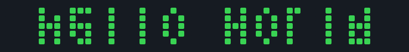
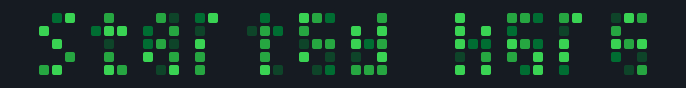

<a href="#about-me">About</a> · <a href="#currently">Currently</a> · <a href="#selected-builds">Projects</a> · <a href="#stack-across-my-repos">Stack</a> · <a href="#stats">Stats</a> · <a href="#connect">Connect</a>

---

### About me

Hey, I'm **Dale (b0urbonn)** — a developer, educator, cybersecurity professional, and founder of **Pixel6**. I build AI-powered mobile & web apps, compete in CTFs and hackathons with **Pixel6** and **WarMachines.exe**, and apparently have a type for late-night debugging sessions.

> *"I ship code by day, break systems by night, and somehow both end up in production."*

### Currently

- **Applied AI** — LLM integrations, on-device intelligence, mobile AI features
- **App development** — Android, React Native, web apps
- **Civic tech** — community information and transparency for Marinduque
- **CTF & hackathons** — security labs, competitions, weekend builds
- **Pixel6** — team, projects, and the future

---

### Selected builds

<table>
<tr>
<td width="50%" valign="top">
<h3>🛡️ <a href="https://github.com/b0urbonn/GabAI">GabAI</a></h3>

A personal AI safety companion.

 
</td>
<td width="50%" valign="top">
<h3>🏝️ <a href="https://github.com/b0urbonn/bettermarinduque">BetterMarinduque</a></h3>

Community-run civic information and transparency for Marinduque, part of the Better LGU movement.

 
</td>
</tr>
<tr>
<td width="50%" valign="top">
<h3>🧹 <a href="https://github.com/b0urbonn/KeepMac">KeepMac</a></h3>

A native macOS storage cleaner built for developers.

 
</td>
<td width="50%" valign="top">
<h3>✦ <a href="https://github.com/b0urbonn/asi-assisted-personal-intelligence">ASI</a></h3>

An upcoming AI personal assistant for tasks, goals, and daily life.

 
</td>
</tr>
</table>

<a href="https://github.com/b0urbonn?tab=repositories">Explore all repositories →</a>

---

### Stack across my repos

Languages

Apps, AI & infrastructure

---

### Activity

 
 

---

### Stats

---

### Connect

Open to projects, collabs & hackathon teams.

